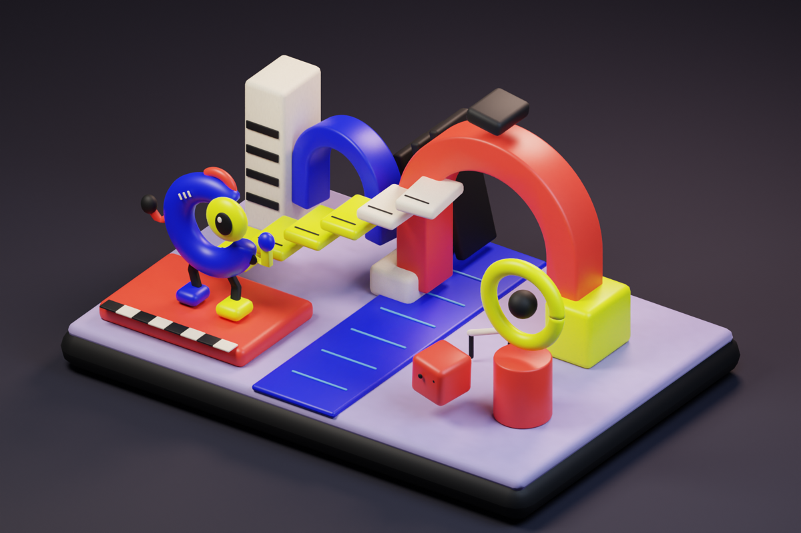

# Crearo / Oddworks

An iOS invention game set in surreal graphic worlds. Build a strange machine from three objects, write a short explanation, and let your one-eyed companion **Loop** test it. The app now opens **Oddworks**, a new construction game that replaces the earlier Paper Theatre home screen.



This is a Blender CPU render of the original models bundled in the app, not an iPhone screenshot. Runtime camera, lighting, mechanisms, and station goals are supplied by RealityKit.

## Play

1. Enter one of six stations: mail a noise, lift a sleeping moon, wake a quiet garden, bend the rain, deliver a spark, or teach the tide to climb.
2. Place three different objects in **Anchor**, **Engine**, and **Twist**. Choose from a fan, bell, spring, mirror, sail, magnet, wheel, and seed. Tap a socket in the 3D scene or use its accessible role button; choosing an already placed object swaps its role.
3. Watch the visible capability totals change. The anchor doubles reach and care; the engine doubles lift and motion; the twist doubles signal. Each station also has its own requirements and constraints.
4. Explain your trick in a short sentence: at least eight words and 24 characters, within 600 characters. Extra words do not increase the score.
5. Test the construction. A finite scene stages the station's goal; **Show the result** remains available throughout. Every rule and the explanation requirement must be met to clear the station.
6. Continue, replay an unlocked station with different objects, or share an experiment from your collection.

Every station has multiple working constructions. **Local puzzle score** is transparent: 70 points for mechanical fit, 20 for visible part range, and 10 for completing the explanation. It is an authored toy construction system, not a physics proof, semantic writing judge, or validated measure of creativity. An impressive-looking number never overrides a failed rule.

## The new art and technology

- **Original Blender models:** Loop's asymmetric crescent body, raised eye, hinge limbs and offset shoes; arched portals, suspended stairs, checker landing, and orbit sculpture. UV-mapped pigment textures carry small enamel flecks. Cobalt, acid yellow, coral, lavender, chalk, and ink replace the paper palette.
- **RealityKit on iOS 17:** a non-AR view, perspective camera, PBR materials, deliberate lights and shadows, custom curved mechanism meshes, selectable sockets, and a bounded physics demonstration. No AR camera session is started.
- **Distinct station goals:** signal rings, a gently lifted sleeping moon, an unfolding flower, redirected rain, a delivered spark, and rising tide stairs. Successful and failed tests resolve differently.
- **SwiftUI:** sharp condensed typography, an architectural scene above a numbered tool rack, visible rules, compact writing, selection feedback, accessible native controls, and separate result, collection, and index surfaces.
- **Lifecycle:** scene-time playback pauses when inactive; Reduce Motion selects the final state; asynchronous asset loads are guarded against stale completion; subscriptions, entities, animations and physics are cleaned up on dismantle.

The [rebuild notes](docs/ODDWORKS_REBUILD.md) explain implementation and validation. The [Swift research](docs/SWIFT_GRAPHICS_RESEARCH.md) links primary Apple references and checks the requested skill packs. The [art source](art/Oddworks/README.md) contains the editable Blender file, reproducible build script, coordinate contract, and USDZ verification results.

## Saves and sharing

Oddworks uses a separate versioned save in Application Support. Per-station text and object drafts are retained, successful recipes enter a collection capped at 60 entries, and best scores persist. Replaying a solved station cannot repeatedly unlock progress. Unreadable or newer save files are preserved; a temporary session explicitly reports that it cannot save over them.

Earlier Paper Theatre saves remain separate. Their submitted inventions and earlier story pages can be read in the new collection. Previous 2D scenes and RPG/AI services remain in the source for reference; they do not define the current launch experience. The old cloud judge and on-device writing coach do not grade the new construction game. Shared results identify the local puzzle rules; no online leaderboard is claimed.

## Run locally

Use Xcode with an iOS 26.4+ SDK, XcodeGen, and a device or simulator supporting iOS 17+. Source compilation was checked with the installed iOS 26.5 SDK.

```sh
cp CrearoApp/Secrets.swift.example CrearoApp/Secrets.swift
xcodegen generate
open Crearo.xcodeproj
```

Select CrearoApp, configure your signing team for a device, and run. The new game works offline and requires no API key or third-party model account. The example secrets file also allows the earlier source to compile; never commit real credentials.

```sh
cd CrearoCore
swift test
```

For a Debug device build, the launch argument `-OddworksDiagnostics` displays RealityKit statistics and physics outlines. Profile on a supported iPhone before making frame-rate, memory, thermal, or battery claims.

## Verification

- **90 Core tests pass**, including 16 new tests, two hand-authored passing recipes per station, enumeration of all 2,016 ordered constructions, failure constraints, role changes, input boundaries, save roundtrips, replay protection and journal limits.
- **34 production-model integration checks pass** for selection, draft persistence, frozen tests, failed and successful attempts, next-station progression, rapid/background writes, unreadable/newer save preservation, and write failure handling.
- Full app Swift source compiles and links for an **iOS 17 simulator target** against the installed iOS 26.5 SDK. XcodeGen includes both USDZ files in the resource build phase.
- Both runtime assets pass Apple's strict USD/ARKit schema checks and were reimported into Blender for geometry, bounds, materials, textures and CPU render verification.

The environment blocks CoreSimulator IPC and Xcode's normal manifest cache, so a complete Xcode build and iPhone/simulator launch have not been verified here. Actual RealityKit appearance, object hit testing, VoiceOver, large Dynamic Type, keyboard layouts, GPU performance and lifecycle behavior still need device testing. Source-rendered UI previews and Blender asset renders are labeled accordingly.

The earlier [Paper Theatre brief](docs/PAPER_THEATRE_DESIGN.md), [24-chapter expansion](docs/CHAPTER_EXPANSION.md), and [SpriteKit/on-device AI update](docs/SPRITEKIT_ON_DEVICE_AI.md) describe previous iterations. Their screenshots and loop descriptions are historical.
