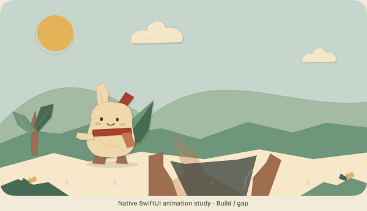

# Crearo

Crearo is an iOS creativity puzzle game. Players invent solutions to unusual situations, receive a visible creativity score out of 100, and advance through levels. The intended experience combines a light, expressive world with satisfying progress and opportunities to compare ideas and scores with friends.

The app's world, **Prism**, uses an original **Paper Theatre** style: a folded-paper companion, layered landscapes, quiet fiber texture, and small scenes that react to the player's invention. There are now 24 authored chapters, with three additional neighborhoods to explore: Pocket Park, Ribbon Market, and Paper Harbor.


This is a source-rendered artwork study, not a simulator screenshot.



This earlier study renders the production drawing code into an animated GIF. It is not a simulator capture or footage of the new SpriteKit runtime. The in-game vignette now runs for 4.4 seconds of active scene time after texture preparation, and players can skip to their score at any time.

## Current player experience

1. Complete the opening and name a companion.
2. Read the chapter's situation, goal, and creative constraint. An optional hint asks a generative question when you need another angle.
3. Receive a score breakdown and practical feedback. Passing ideas get a short Paper Theatre scene; offline grades are labeled practice estimates.
4. Reach the level's required score to advance. Failed answers can be refined and retried.
5. Continue straight into the next chapter. Streaks count days played, so clearing several chapters in one day counts as one streak day.
6. Revisit your actual inventions, scores, and story in the journal. Share an invention through the native share sheet; practice scores remain explicitly labeled local estimates.

Drafts are saved by chapter and restored after relaunch. Clearing a chapter removes that chapter's draft and archives its submitted invention. Existing saves keep their progress and earlier story pages. After all 24 authored chapters, the bank cycles; the pass mark caps at 78. Progress is saved locally as JSON, with the most recent 120 inventions retained alongside the story log.

The stage includes 17 obstacle/prop archetypes and eight invention silhouettes. SpriteKit now supplies nine finite action sequences, companion reactions, and physics-driven paper scraps. Players can tap the finished stage to cheer, with an equivalent VoiceOver action. Playback pauses outside the foreground, Reduce Motion shows a static outcome, and native score controls remain available. Park foliage and picnic cloth, market awnings and banners, and harbor water, boats, and lighthouse give the neighborhoods distinct settings. Failed attempts keep the draft and grant no rewards; successful attempts update rewards, world growth, and progression once for that chapter, using the same assessment.

Offline feedback now looks for authored clues about the current goal and an explained action, offers a concrete revision prompt, and checks for low-information or repeated answers. Short explanations can score well. All 24 chapters have plausible passing examples using the unchanged rubric and score gates. This establishes reachable progression, not a validated measure of creativity.

On eligible iOS 26+ devices with Apple Intelligence available, an optional Foundation Models coach adds a specific strength, one revision, and stage cues drawn from the player's answer. This device-local path sends no answer to a server and requires no API key. It does not determine the numeric score, rewards, or progression. Unavailable models, invalid output, long inputs, errors, or an eight-second deadline return to the usual practice feedback. iOS 17 remains supported.

## Development direction and known gaps

The [SpriteKit and on-device AI notes](docs/SPRITEKIT_ON_DEVICE_AI.md) describe the latest implementation, framework choices, and device checks still needed. The [Axiom SpriteKit audit](docs/SPRITEKIT_AUDIT.md) records source and lifecycle validation. The [chapter expansion notes](docs/CHAPTER_EXPANSION.md) describe the gameplay and content update. The [Paper Theatre design brief](docs/PAPER_THEATRE_DESIGN.md) explains the research, motion guidance, and a first-session playtest. The earlier [direction brief](docs/CREARO_DIRECTION.md) records the historical starting audit; its proposed twelve-chapter expansion is now implemented.

The next work needs to address these concrete gaps:

- **Scoring:** local English word/phrase checks remain practice proxies. They cannot verify novelty, real-world mechanisms, negation, relational constraints, or genuine conceptual diversity. A goal-word hit is not proof that an invention solves the problem. Scores need human calibration before authoritative comparison.
- **World and content:** arbitrary inventions still map to a bounded set of silhouettes; the 24-chapter bank eventually repeats.
- **Social comparison:** there is no leaderboard or shared, server-verified challenge score system yet.

Validation: all 74 core tests pass, including eight checks for grounded model output and unsupported score/reward claims. A separate harness using the production AppState and services verifies draft storage, failed/repeated reward protection, same-day chapter progression, day-based streaks, the late offline gate, journal/relaunch recovery, and the input limit. The real app source compiles and links against the installed iOS 26.5 simulator SDK with an iOS 17 deployment target. A native macOS harness also exercises the production SpriteKit scene's staging, physics masks, pool limits, Reduce Motion, cleanup, and deallocation. An Xcode build, simulator launch, actual on-device model generation, device performance, VoiceOver, keyboard behavior, and large Dynamic Type still require hands-on verification.

The existing design documents also describe an earlier dark-fantasy survival RPG with hidden creativity scores. Those documents contain useful systems and research, but they do not describe the current app's complete player flow. The direction brief records the current goal of visible scores, level progression, and a light visual identity.

## Run locally

Requirements: Xcode with an iOS 26.4 or later SDK for the full coach implementation, XcodeGen, and a simulator or device supporting iOS 17 or later. Compilation was verified with the installed iOS 26.5 SDK. Test real Foundation Models generation on an eligible physical device with Apple Intelligence enabled and its model ready.

Run the platform-independent game-logic tests:

```bash
cd CrearoCore
swift test
```

From the repository root, create the local configuration and generate the Xcode project:

```bash
cp CrearoApp/Secrets.swift.example CrearoApp/Secrets.swift
xcodegen generate
open Crearo.xcodeproj
```

Leave `anthropicAPIKey` empty to use the local practice evaluator and, when available, the device-local idea coach. To try the existing remote AI challenge grading and scene direction locally, set your Anthropic key in the gitignored `Secrets.swift`; that path sends the submitted answer and recent story context to the configured remote judge. This direct API configuration is for local testing; a released app needs server-side model credentials and authoritative scoring. No authenticated remote call or device-local generation was performed during this update.

In Xcode, select the `CrearoApp` scheme, choose a simulator or device, and run. For a physical device, configure your signing team and bundle identifier.

## Repository layout

| Path | Purpose |
| --- | --- |
| `CrearoApp/` | SwiftUI app, daily level flow, cut-scenes, local persistence, and AI integration |
| `CrearoCore/` | Foundation-only Swift package for the challenge catalog, practice checks, saves, scoring, economy, and progression |
| `docs/CREARO_DIRECTION.md` | Historical starting audit and world expansion proposal |
| `docs/CHAPTER_EXPANSION.md` | Implemented 24-chapter expansion, validation, and remaining limits |
| `docs/PAPER_THEATRE_DESIGN.md` | Research, Paper Theatre design decisions, limitations, and playtest protocol |
| `docs/SPRITEKIT_ON_DEVICE_AI.md` | SpriteKit implementation, optional Foundation Models coach, compatibility, and validation |
| `docs/SPRITEKIT_AUDIT.md` | Axiom source audit and native scene lifecycle checks |
| `docs/previews/` | Native source-rendered artwork studies, not device screenshots |
| `docs/` | Earlier game design, story, scoring research, architecture, roadmap, and setup guides |
| `supabase/` | Backend schema and Edge Functions for the earlier forge and originality systems |
| `project.yml` | XcodeGen project specification |

Forge, home-base, and other earlier RPG systems remain in the codebase, but the current root view opens the daily level experience. Supabase setup is optional for those earlier systems; the visible challenge judge currently uses the separate local-testing AI path described above.
