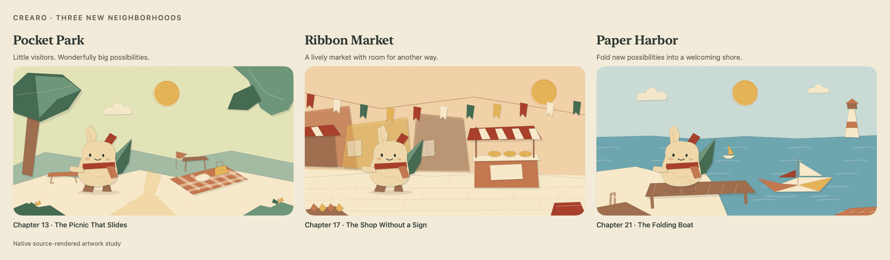

# Chapter expansion and invention journal

Implemented October 19, 2026. This update extends the Paper Theatre experience and makes the main invention loop playable at the player's pace.

## More places to invent

The original twelve Prism challenges retain their order, text, and focus dimensions. Chapters 13–16 enter Pocket Park; 17–20 visit Ribbon Market; 21–24 reach Paper Harbor. Each chapter now has a stable content ID, typed obstacle, exact scene target, explicit creative constraint, optional hint, and a practical revision prompt. Calendar IDs remain compatible with earlier saves. Beyond chapter 24 the catalog cycles; the score threshold continues to cap at 78.

The three settings have distinct hand-authored scenery: leaf canopies and picnic cloth, cloth banners and bakery fronts, and water with folded sails, a jetty, and a lighthouse. Seven added props bring the stage to 17 obstacle/prop archetypes. Existing finite scenes and Reduce Motion support remain. This image renders production drawing code; it is not a simulator screenshot.

## A loop that keeps the player's work

- A passing idea opens the next chapter immediately. The streak counts distinct consecutive days, not the number of chapters cleared.
- Drafts are kept by level, coalesced into local storage while typing, and flushed when the app leaves the active state. A cleared chapter removes only its own draft. Inputs over 12,000 characters remain saved but must be shortened before evaluation; the app does not silently grade a prefix.
- A clear archives the exact invention, chapter, score, grading mode, date, and story. The newest 120 invention records are retained; older story beats remain available. Earlier saves decode with empty new fields and preserve their existing progress, resources, profile, and story.
- Result and journal share actions use the native share sheet. The text identifies local practice estimates or AI feedback and says the score is saved locally and not independently verified. There is no public leaderboard.
- Local scene direction matches whole words and preserves a named heading. A heartbeat lantern no longer becomes an attack through the substring `beat`; a first explicit blue color is not overridden by a later golden detail. Repeating an idea gives stable local direction.
- AI scene requests include the current constraint and up to three recent story beats. API model/settings are otherwise unchanged. No authenticated model request was tested.

## What practice feedback can establish

The new deterministic evaluator receives each chapter's goal and broad authored word/phrase clues. It looks for an explained action/effect, concrete detail, and enough separately worded sections when several approaches are requested. It detects empty/generic answers, bare word lists, repeated sentences, and some unrelated prose. Additional length saturates quickly, so concise explanations can pass. The same six-criterion rubric and level gates still drive scores and progression.

The former 77-point ceiling belonged to the previous offline adapter. All 24 current chapter profiles have manually authored plausible examples that pass their actual gates, with scores of 84–92. A 20-word lighthouse example scores 84 against its 78-point target. An unrelated companion-baking response scores 21 against the canyon challenge's 57-point target. These are regression checks of reachability and obvious mismatch handling, not human calibration.

The evaluator is still a bounded English lexical heuristic. Goal-word hits cannot prove the goal is fulfilled, and it cannot verify novelty, physical plausibility, negation, relational constraints, or conceptual diversity. List checks compare word sets between sections, not distinct ideas in a semantic sense. Most constraints are guidance for the player and the AI judge rather than automatically checked local rules. Scores can saturate at the same feature combination; the interface therefore calls them practice estimates. Human playtesting and judge calibration remain necessary before fair social ranking or claims about creativity training.

## Verification

All 66 Core tests pass, including save migration, exact invention/draft round trips, repeated-clear protection, consecutive-day streaks, stable scene direction, catalog coverage, adversarial practice inputs, and a plausible passing answer for every chapter.

A separate native harness runs production AppState and services with an explicit empty model key and an in-memory store. It verifies failed attempts grant nothing; a clear archives the exact answer; repeated cleared-level submissions cannot pay again; another chapter can clear that day without inflating the streak; chapter 12 can clear offline and open Pocket Park; drafts and history survive a simulated relaunch; old editor callbacks do not restore cleared drafts; and oversized submissions do not mutate progress.

The real iOS source compiles and links with an iOS 17 deployment target against the simulator SDK. XcodeGen regenerates the project. An actual Xcode build/launch, device performance, keyboard navigation, VoiceOver, and large Dynamic Type remain unverified. Native artwork renders and compiler checks do not replace those tests.
